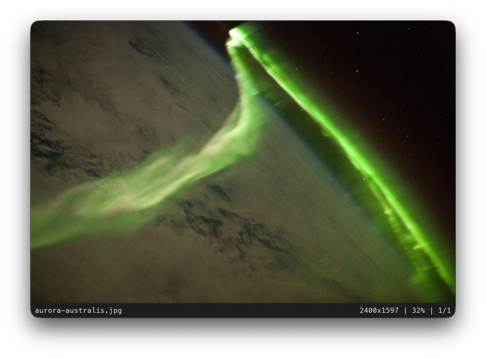
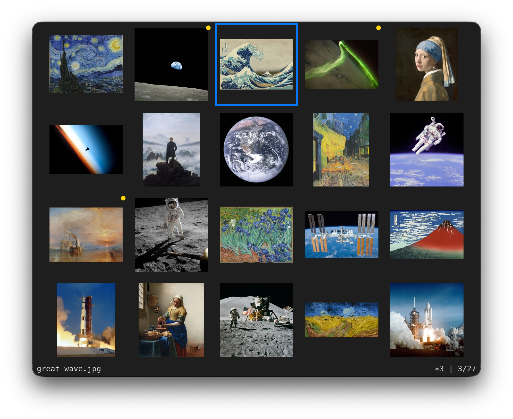
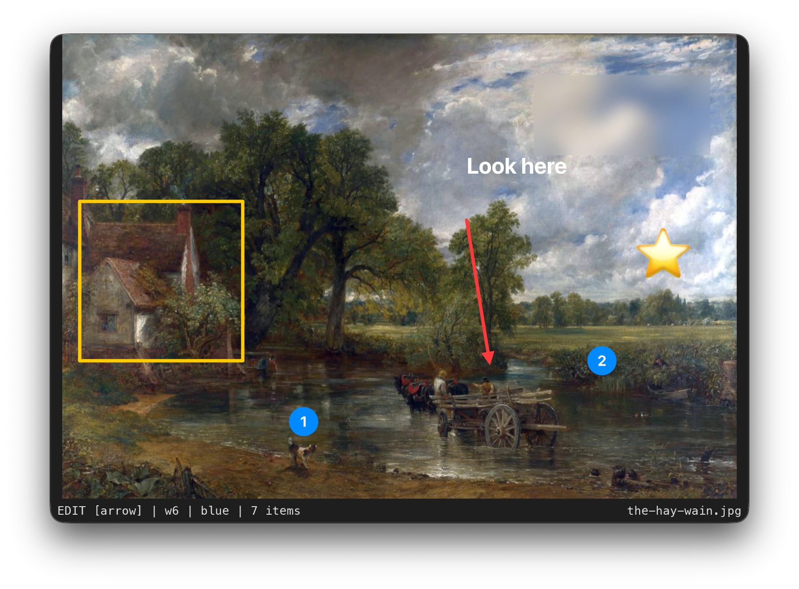
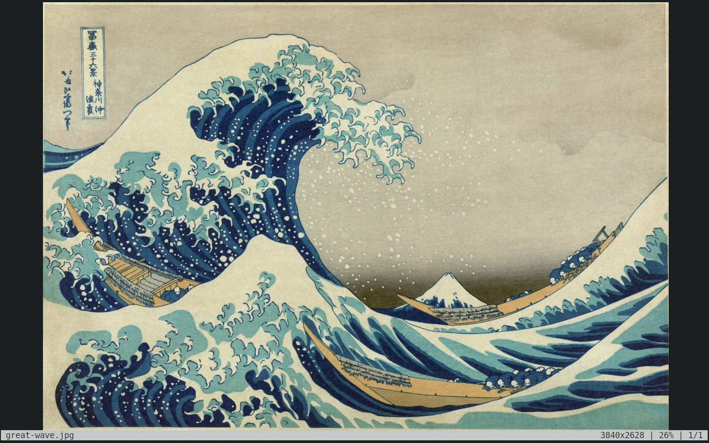

# nsxiv-ng

nsxiv-ng is a keyboard-driven image viewer for Linux and macOS.

On Linux it opens a Wayland window in a Wayland session and an X11 window otherwise. With no
display, as over SSH on a headless machine, it shows the images in the terminal. On macOS it
opens an AppKit window and needs macOS 13 or later.

<p align="center">
  
  
</p>
<p align="center">
  
  
</p>

## Contents

- [Features](#features)
- [File manager integration](#file-manager-integration)
- [Install](#install)
  - [Linux](#linux)
  - [macOS](#macos)
  - [Install with an agent](#install-with-an-agent)
- [Keys](#keys)
- [Edit mode](#edit-mode)
- [Usage](#usage)
- [In the terminal](#in-the-terminal)
- [The status bar](#the-status-bar)
- [key-handler](#key-handler)
- [Configuration](#configuration)
- [Formats](#formats)
- [The sandbox](#the-sandbox)
- [Building](#building)
- [License](#license)

## Features

- Image mode with zoom, pan, rotation, flips, gamma and contrast.
- The window takes each image's size, capped to the screen, as [mpv](https://mpv.io)'s does.
  `-g WxH` fixes the size instead.
- A thumbnail grid. It reads and writes the
  [freedesktop thumbnail cache](https://specifications.freedesktop.org/thumbnail-spec/latest/)
  that file managers share. With `-p` it reads the cache and writes nothing to it.
- Animated GIF, APNG and WebP play, and you can step through their frames.
- The image reloads when its file changes on disk.
- Marks for batch work. `-o` prints the marked files when the viewer quits.
- Shell scripting through a key-handler, with nsxiv's protocol.
- A slideshow.
- Edit mode: arrows, shapes, text, stamps, censors and a spotlight, saved as a new PNG beside
  the image or copied to the clipboard. On macOS it also reads text and barcodes for the
  clipboard, censors faces and personal data, and removes backgrounds.
- JPEG XL, HEIC, AVIF and SVG open, camera RAW files show their embedded JPEG preview, and
  Photoshop documents show their composite image.

## File manager integration

`etc/nsxiv-rifle` opens a single image and lets you browse its whole directory, starting at
that file, in the order nsxiv-ng gives a directory itself. Several files, or a directory, open
as they are. For [yazi](https://github.com/sxyazi/yazi), add this to `~/.config/yazi/yazi.toml`,
where yazi keeps its settings on Linux and macOS. Create the file if it is not there.

```toml
# an opener named nsxiv that runs nsxiv-rifle on the file yazi opens
[opener]
nsxiv = [
  { run = 'nsxiv-rifle %s', desc = "nsxiv-ng", for = "unix" },
]

# a rule ahead of yazi's own that opens every image with that opener
[open]
prepend_rules = [
  { mime = "image/*", use = "nsxiv" },
]
```

With no display, the viewer needs yazi's terminal. Add `block = true` to the opener, and yazi
waits until you quit the viewer.

On macOS, nsxiv-ng.app appears in Finder's Open With menu for every format it reads.

## Install

Download the archive for your system from the [latest release](../../releases/latest).

### Linux

There are archives for x86_64 and aarch64. Unpack the one for your machine and copy `nsxiv-ng`
into a folder on your `$PATH`. It needs [libxkbcommon](https://xkbcommon.org) at run time, and
the status bar's text needs an installed font. HEIC, HEIF and AVIF need
[libheif](https://github.com/strukturag/libheif) (`libheif.so.1`) with its decoders:
`libheif1`, `libheif-plugin-libde265` and `libheif-plugin-dav1d` on Debian, `libheif` on Arch.
Without libheif those three formats do not open, and the rest do.

### macOS

Unzip it and move `nsxiv-ng.app` to `/Applications`. The app runs on Apple silicon and Intel
Macs. It carries an ad hoc signature rather than a developer's, so macOS quarantines it after
a download and refuses to open it. This command clears the quarantine:

```sh
xattr -dr com.apple.quarantine /Applications/nsxiv-ng.app
```

Finder then offers nsxiv-ng in its Open With menu, without making it the default for any
format. To run it from a terminal too, link
`/Applications/nsxiv-ng.app/Contents/MacOS/nsxiv-ng` into a folder on your `$PATH`.

Opened from Finder with no file, the app waits two seconds for one, then quits. Files you open
while it runs go into its list after the current file, and the first of them shows.

### Install with an agent

Paste this prompt into a coding agent that can run commands on the machine.

<details>
<summary>The prompt</summary>

```text
Install the image viewer nsxiv-ng on this machine from its latest release:
https://github.com/hawkff/nsxiv-ng/releases/latest

1. Find this machine's OS and CPU architecture and pick the matching release asset.
   If none matches, stop and tell me.
2. Download it with curl. If the release has a checksum file, check the download against it.
3. On Linux: unpack it and copy nsxiv-ng into ~/.local/bin, creating the folder if needed,
   and tell me if that folder is not on my PATH. Check that libxkbcommon is installed, and
   libheif with its HEIC and AVIF decoders. If either is missing, show me the package
   manager's command and ask before you run it.
4. On macOS: unzip it and move nsxiv-ng.app to /Applications, asking before you replace an
   older copy. Clear its quarantine with
   xattr -dr com.apple.quarantine /Applications/nsxiv-ng.app
   and link /Applications/nsxiv-ng.app/Contents/MacOS/nsxiv-ng into a folder on my PATH.
5. Run nsxiv-ng -v and show me what it prints.
6. Ask me whether I want the example key-handler. If I do, copy etc/key-handler.example from
   the release, or from the repository at the release's tag, to
   ~/.config/nsxiv-ng/exec/key-handler and make it executable. Keep any key-handler I have.
7. Ask me whether I want file manager integration. If I do, copy etc/nsxiv-rifle next to
   nsxiv-ng and make it executable. If yazi is installed, show me the opener and the rule
   from the README's "File manager integration" section, then add them to
   ~/.config/yazi/yazi.toml and keep everything already in it.

Ask before any command that needs sudo. Change nothing else on the machine.
```

</details>

To build nsxiv-ng yourself, see [Building](#building).

## Keys

The keys are nsxiv's. There are no count prefixes.

| Key | Action |
| --- | --- |
| `q` | quit; with `-o`, print the marked files |
| `Q` | quit and print the current file |
| `Return` | switch between image and thumbnail mode |
| `f` | fullscreen |
| `b` | show or hide the status bar, which starts hidden |
| `j` `k` | next and previous image; a beep past either end |
| `]` `[` | 10 images forward and back |
| `g` `G` | first and last image |
| `BackSpace` | previous image |
| `h` `l` `u` `d`, arrows | pan the image by a fifth of the view |
| `H` `J` `K` `L` | pan to the left, bottom, top and right edge |
| `C-h` `C-j` `C-k` `C-l`, `C-` arrows | pan by a whole view |
| `+` `-` | zoom in and out through the zoom levels |
| `=` | zoom to 100% |
| `w` | scale mode down: shrink a large image to fit, leave a small one at 100% |
| `W` `F` `e` `E` | scale mode fit, fill, width and height |
| `z` | center the image |
| `<` `>` `?` | rotate 90° counterclockwise, 90° clockwise, 180° |
| `\|` `_` | flip horizontally and vertically |
| `{` `}` | gamma down and up |
| `(` `)`, `C-[` `C-]` | contrast down and up |
| `C-g` | reset gamma |
| `a` | antialiasing on and off |
| `A` | alpha checkerboard on and off |
| `x` | edit mode; see [Edit mode](#edit-mode) |
| `m` | mark or unmark the image and go to the next one |
| `M` | mark or unmark every file from the one marked last to this one |
| `C-m` `C-u` | reverse every mark, clear every mark |
| `N` `P` | next and previous marked image |
| `r` | reload the image |
| `D` | remove the image from the list; removing the last one quits |
| `s` | start or stop the slideshow |
| `S` | add a second to the slideshow's delay, up to 600 |
| `C-n` `C-p` | next and previous frame of an animation |
| `C-Space` `C-a` | play or pause an animation |
| `C-6` | the image shown before |
| `C-x KEY` | pass KEY and the files to your key-handler; `Escape` cancels |

In thumbnail mode:

| Key | Action |
| --- | --- |
| `h` `j` `k` `l`, arrows | move the selection |
| `+` `-` | larger and smaller thumbnails |
| `C-j` `C-k` | page down and up |
| `Return`, `Space` | open the selected image |
| `R` | make every thumbnail again |

These keys of image mode work in the grid too: `q` `Q` `f` `b` `g` `G` `r` `D` `m` `M` `C-m`
`C-u` `N` `P` `C-6` and `C-x`.

With the mouse, a click in the left or right third of the image goes to the previous or next
image, and a drag pans. The right button switches to the grid, and in the grid it marks the
cell under it. In the grid a click selects and a double click opens. The scroll wheel zooms the
image and scrolls the grid. On Wayland and macOS a touchpad pans the image.

Where the compositor draws no title bar, as on [GNOME](https://www.gnome.org) and
[Weston](https://gitlab.freedesktop.org/wayland/weston), the viewer draws one. Drag it to move
the window, double-click it to maximize, right-click it for the window menu, click the `×` to
close, and drag the window's edges to resize it.

On macOS the image fills the window, and the title bar fades in when the pointer reaches the
top edge. A pinch, or the scroll wheel with Control or Option held, zooms about the pointer.
`Cmd-Q` quits as `q` does.

## Edit mode

Press `x` on an image to annotate it. Edit mode works in the X11, Wayland and macOS windows;
in the terminal `x` prints a warning and beeps. The status bar shows while an edit runs, even
when it is hidden, and names the tool. The annotations stay editable until you leave. `w`
saves `NAME-edit.png` beside the image, or `NAME-edit-1.png` and on where that name is taken,
and shows it next. `q` leaves without saving. The viewer never changes the image's own file.

| Key | Tool |
| --- | --- |
| `v` | select: click an annotation, drag it to move it, drag a corner handle to resize it, `D` or `Delete` removes it, a double click on text edits it again |
| `a` | arrow |
| `r` `e` | rectangle and ellipse; `f` cycles stroke, stroke and fill, and fill |
| `t` | text: click to place it, type, then `Return` or `Escape` |
| `p` `m` | pencil and marker |
| `n` | numbered badge, counting up |
| `s` | emoji stamp; `<` `>` step through 21 emoji |
| `c` | censor the dragged region; `C` cycles pixelate, blur and solid |
| `h` | spotlight: the region stays bright and the rest dims |

| Key | Action |
| --- | --- |
| `1` to `8` | color: red, orange, yellow, green, blue, purple, black, white |
| `[` `]` | line width |
| `{` `}` | text and emoji size |
| `u` `U` | undo and redo |
| `Space`, held | move the shape you are drawing instead of resizing it |
| `I` | invert the colors; press it again to undo |
| `C-c` | copy the edited image to the clipboard as a PNG |
| `w` | save and show the saved file |
| `q` | leave without saving |
| `Escape` | drop the selection, or with none, leave without saving |
| `o` | copy the image's text (macOS) |
| `Q` | copy the payloads of QR codes and barcodes (macOS) |
| `F` | censor every face (macOS) |
| `P` | censor personal data in the text: email addresses, phone, card and social security numbers, API keys and tokens (macOS) |
| `B` | remove the background (macOS 14 and later) |

On macOS, `Cmd-Z`, `Shift-Cmd-Z`, `Cmd-C` and `Cmd-S` undo, redo, copy and save. On Linux,
`C-z`, `C-Z`, `C-c` and `C-s` do the same, and the five recognition keys say that the system
recognizes nothing and beep. The recognition keys use Apple's
[Vision](https://developer.apple.com/documentation/vision). Ask for several in a row and each
one answers in turn.

On macOS the text tool opens the system's text field. In an X11 or Wayland window the viewer
draws a line of its own, which takes the characters your keyboard layout and its Compose
sequences type.

## Usage

```sh
nsxiv-ng [-bfiopqrtv] [-g WxH] [-n NUM] [-S DELAY] [-s MODE] [-z ZOOM] FILE...

nsxiv-ng ~/Pictures                     # every image in a directory
nsxiv-ng -r ~/Pictures                  # recurse into subdirectories
fd -e jpg | nsxiv-ng -i                 # read the file list from stdin
nsxiv-ng -o *.jpg > picked.txt          # mark with m, quit; marked paths print to stdout
```

The third example uses [fd](https://github.com/sharkdp/fd).

| Option | Effect |
| --- | --- |
| `-b` | start with the status bar hidden, whatever `show_bar` says |
| `-f` | start in fullscreen |
| `-g WxH` | fixed window size instead of fitting the window to each image |
| `-i` | read file paths from stdin, one a line |
| `-n NUM` | start at file number NUM |
| `-o` | print marked files to stdout on quit |
| `-p` | private mode, do not write a thumbnail cache |
| `-q` | be quiet, disable warnings |
| `-r` | search directories recursively |
| `-S DELAY` | start slideshow with DELAY seconds between images |
| `-s MODE` | set scale mode: `d`=down, `f`=fit, `F`=fill, `w`=width, `h`=height |
| `-t` | start in thumbnail mode |
| `-v` | print version and exit |
| `-z ZOOM` | set zoom level in percent |
| `-h` | print the usage and exit |

Short options cluster as with getopt: `-rt` is `-r -t`, and `-n5` is `-n 5`. Each option also
has a long name: `--no-bar`, `--fullscreen`, `--geometry`, `--stdin`, `--start-at`, `--output`,
`--private`, `--quiet`, `--recursive`, `--ss-delay`, `--scale-mode`, `--thumbnail`,
`--version`, `--zoom` and `--help`. Paths after `--` may start with a dash.

A directory adds the images in it, sorted as a file manager sorts names: without regard to
case, and with runs of digits by their value, so `img2` comes before `img10`. Hidden files stay
out, and on macOS so do files that Finder hides. A file you name on the command line opens
whatever its name, since the viewer tells formats by their content.

The window's title shows the file's name.

## In the terminal

With no display, the viewer runs in the terminal, with the status bar on the last line. It asks
the terminal what it can show:

- A terminal with the [kitty graphics protocol](https://sw.kovidgoyal.net/kitty/graphics-protocol/)
  gets each image at full resolution. The terminal keeps the frames the viewer sent, so going
  back to an image is quick.
- A terminal with [sixels](https://en.wikipedia.org/wiki/Sixel) that reports its size in pixels
  gets sixels.
- Any other terminal gets half-block cells, in 24-bit, 256 or 16 colors as `COLORTERM` and
  `TERM` say.

In [tmux](https://github.com/tmux/tmux), kitty graphics need `set -g allow-passthrough on`.

The keys stay the same, and `C-c` quits too. `C-m` arrives as `Return` and `C-[` as `Escape`,
because terminals send the same bytes for them.

## The status bar

The bar starts hidden; `b` shows it, and `show_bar = true` in the config shows it at start. It
shows the file's name on the left. On the right, in this order and where they apply, it shows
the slideshow's delay, the gamma and contrast steps, the number of marked files, `*` when this
file is marked, the animation's state and frame, the image's size, the zoom, and the file's
number out of the total. A bar too narrow for all of that drops fields from the left, so the
file's number stays longest.

An image that cannot be shown leaves its reason in the image area: `could not load: NAME`,
`too large: WxH` when the image needs more memory than the viewer allows, or
`could not load: no preview in RAW`.

## key-handler

Place an executable at `~/.config/nsxiv-ng/exec/key-handler`. After you press `C-x` in the
viewer, the next key arrives as `$1`, with `C-` before it when you held Control. The marked
files, or the current file when none is marked, arrive on stdin, one path a line. The viewer
waits until the handler ends. Then it reads the files again and drops from the list any the
handler deleted. A file whose name contains a newline would reach the handler as two paths, so
the viewer leaves it out and warns.

`etc/key-handler.example` copies the paths (`c`), copies the image (`y`), moves the files to
the trash (`t`) and opens the folder (`r`). On Linux it uses
[wl-clipboard](https://github.com/bugaevc/wl-clipboard) or
[xclip](https://github.com/astrand/xclip), [file](https://github.com/file/file),
[gio](https://gitlab.gnome.org/GNOME/glib) and
[xdg-open](https://gitlab.freedesktop.org/xdg/xdg-utils). On macOS it uses the system's
`pbcopy`, `osascript` and `open`.

## Configuration

nsxiv-ng reads `$XDG_CONFIG_HOME/nsxiv-ng/config.toml`, or `~/.config/nsxiv-ng/config.toml`
where that variable is unset, on Linux and macOS alike. The file is optional, and so is each
key in it. A key or value the viewer cannot take gets a warning that names its line, and that
key keeps its default. The viewer ignores a file with a syntax error as a whole. Key bindings
are compiled in.

| Key | Default | Meaning |
| --- | --- | --- |
| `window_width` | `800` | the window's width before the first image fits it |
| `window_height` | `600` | its height |
| `slideshow_delay` | `5` | seconds between slideshow images |
| `cc_steps` | `32` | gamma and contrast steps each way, 2 or more |
| `gamma_max` | `10` | the gamma of the top step, 1 or more |
| `contrast_max` | `4` | the contrast of the top step, 1 or more |
| `zoom_levels` | `[0.125, 0.25, 0.5, 0.75, 1, 1.5, 2, 4, 8]` | what `+` and `-` step through, ascending |
| `pan_fraction` | `5` | a pan key moves the view by 1/`pan_fraction` of it |
| `thumb_sizes` | `[32, 64, 96, 128, 160]` | thumbnail sizes in the grid, ascending |
| `thumb_size_index` | `3` | the grid's starting size, an index into `thumb_sizes` |
| `thumb_padding` | `10` | space around each thumbnail |
| `nav_width_fraction` | `0.33` | the share of the window at each side that a click navigates in, at most 0.5 |
| `background` | `"#ffffff"` | behind the image and the grid |
| `foreground` | `"#000000"` | the text in the bars and the reason an image did not load |
| `show_bar` | `false` | the status bar shows at start; `b` shows and hides it either way |
| `bar_background` | `"#eeeeee"` | the status bar, the drawn title bar, a thumbnail not made yet |
| `selection_color` | `"#3478f6"` | the selected thumbnail's border |
| `mark_color` | `"#ffcc00"` | a marked thumbnail's sign |
| `bar_font` | `"monospace"` | a font family; `monospace` is the system's monospaced font |
| `bar_font_size` | `13` | in logical pixels |
| `image_cache_percent` | `3` | the decoded-image cache's share of the memory |
| `image_cache_max_mib` | `256` | and its cap in MiB |
| `max_image_percent` | `25` | the viewer refuses an image that needs more of the memory than this |
| `animation_budget_mib` | `256` | the memory an animation's decoded frames may hold |

Sizes and widths are logical units, which a scaled screen multiplies. On macOS, a color the file
leaves unset follows the system's light or dark appearance.

## Formats

The viewer tells a file's format by its content. TGA and SVG carry no signature and go by their
names, as do camera RAW files that start as TIFF.

These decode in the viewer itself:

- JPEG, PNG and APNG, GIF, WebP, TIFF, BMP, ICO, TGA, PBM, PGM, PPM, PNM, PAM, QOI, farbfeld,
  OpenEXR and Radiance HDR, through the [image](https://github.com/image-rs/image) crate
- JPEG XL, through [jxl-rs](https://github.com/libjxl/jxl-rs); an animated one shows its first
  frame
- JPEG 2000, through [hayro-jpeg2000](https://github.com/LaurenzV/hayro)
- XPM and XBM, through [image-extras](https://github.com/image-rs/image-extras)
- camera RAW by its embedded JPEG preview: CR2, CR3, NEF, NRW, ARW, SRF, SR2, DNG, PEF, SRW,
  ERF, ORF, RW2 and RAF; a RAW file without a preview says so
- Photoshop documents (PSD and PSB) by their composite image; the viewer refuses by name a
  document saved without it, and Lab, multichannel and 32-bit documents
- Apple icon files (ICNS), by their largest icon
- on macOS, HEIC, HEIF and AVIF, through Apple's
  [ImageIO](https://developer.apple.com/documentation/imageio)

These decode in a sandboxed helper process:

- SVG and SVGZ, through [resvg](https://github.com/linebender/resvg)
- on Linux, HEIC, HEIF and AVIF, through the system's
  [libheif](https://github.com/strukturag/libheif)

The viewer applies EXIF orientation and converts images with an ICC profile to sRGB.

## The sandbox

Two to four helpers run at a time. The viewer ends one that takes longer than 30 seconds on a
file, and a helper ends when its viewer does. A helper that cannot lock itself down decodes
nothing.

On Linux, a helper loads its fonts and libheif, then locks itself down with
[seccomp](https://man7.org/linux/man-pages/man2/seccomp.2.html) and
[Landlock](https://landlock.io) before it reads a file. After that it can open no file, run no
program, make no socket and use no
[io_uring](https://man7.org/linux/man-pages/man7/io_uring.7.html).

`-v` prints the version and, on a second line, what the sandbox does on this machine:

```text
nsxiv-ng 0.0.1
sandbox: seccomp, landlock full; libheif VERSION
```

Landlock reads `partial` where the kernel's Landlock is older than the one the helper asks for,
as on Debian 13. That kernel lacks one right, connecting to a UNIX socket by its path, which
the seccomp filter refuses in any case. It reads `none` on a kernel without Landlock, where
seccomp alone holds the helper. `no libheif` stands where libheif is missing.
`, a plugin did not load` follows the version where libheif could not load one of its codec
plugins; the formats its other decoders cover still open. `sandbox: none (REASON)` or
`sandbox: broken, ... got through` means SVG, HEIC, HEIF and AVIF do not open.

On macOS, a helper maps its fonts and then enters a Seatbelt profile that denies everything it
does not need. It can then read or write no file, start no process, open no network or UNIX
socket, look up no system service and signal no other process. `-v` then prints
`sandbox: seatbelt`. macOS sets no memory limit on a single process, so the viewer's size check
and the 30-second limit bound a helper there.

## Building

nsxiv-ng builds with cargo and needs Rust 1.99 or later, which [rustup](https://rustup.rs)
installs. On Linux it also needs the libxkbcommon headers and
[pkg-config](https://github.com/pkgconf/pkgconf):

```sh
sudo apt install libxkbcommon-dev pkg-config    # Debian
sudo pacman -S libxkbcommon pkgconf             # Arch
cargo build --release --locked -p nsxiv-ng
```

The binary is `target/release/nsxiv-ng`. Copy it into a folder on your `$PATH`.

On macOS it needs the
[Command Line Tools](https://developer.apple.com/documentation/xcode/installing-the-command-line-tools/)
as well. To build the app:

```sh
dist/macos/app.sh
```

This makes `target/release/nsxiv-ng.app`. Move it to `/Applications`. An app you build on the
same Mac carries no quarantine.

## License

MIT.
